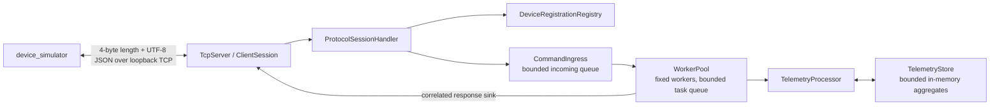

# TelemetryHub

TelemetryHub is a working C++20 portfolio project: a Windows localhost TCP server that accepts device telemetry, keeps bounded in-memory statistics, and returns request-correlated responses. The `telemetry_server` and `device_simulator` executables provide a small end-to-end demonstration.

The project demonstrates RAII Winsock ownership, nonblocking TCP I/O, bounded length-prefixed messages, typed UTF-8 JSON, `std::jthread` and cooperative cancellation, bounded queues and backpressure, a fixed worker pool, thread-safe domain processing, and orderly shutdown. MSVC builds use strict `/W4 /WX` warnings.

## Requirements

- Windows 10 or later, Visual Studio 2022 with the C++ desktop workload and Windows SDK.
- CMake 3.25 or newer and Git.
- Network access during the first configure so CMake FetchContent can download pinned GoogleTest 1.17.0 and nlohmann/json 3.12.0.

## Build and test

From a Visual Studio Developer PowerShell:

```powershell
git clone https://github.com/annaiurgenson/telemetry-hub.git
cd telemetry-hub
cmake --preset windows-msvc
cmake --build --preset windows-msvc-debug --parallel
ctest --preset windows-msvc-debug --output-on-failure
```

The preset uses Visual Studio 2022 x64, enables tests, and places Debug executables in `build\windows-msvc\Debug`. The full CTest suite includes unit tests and localhost integration tests. To repeat the concurrency and protocol-session suites 20 times:

```powershell
ctest --preset windows-msvc-debug `
  --tests-regex '^(WorkerPool|CommandIngress|TcpServer|ProtocolSession)\.' `
  --repeat until-fail:20 --output-on-failure
```

GitHub Actions runs the same MSVC preset on `windows-2022`, checks the full suite, and repeats an explicit concurrency/integration test selection. Check Actions for the result attached to the specific commit; a local pass or workflow file alone does not establish hosted CI success.

## Run the demonstration

Open two PowerShell terminals in the repository root. In the first, start the server on a known loopback port:

```powershell
.\build\windows-msvc\Debug\telemetry_server.exe --port 5000
```

In the second, run the device simulator:

```powershell
.\build\windows-msvc\Debug\device_simulator.exe --port 5000
```

The simulator registers `demo-sensor-1`, submits temperature readings `21.5`, `22.0`, and `23.5`, requests statistics, then exits. Press Enter in the server terminal to stop the server cleanly.

Example output from a fresh server instance (the receive timestamp varies):

```text
Connected to 127.0.0.1:5000
Registered device demo-sensor-1
Telemetry accepted: temperature=21.50
Telemetry accepted: temperature=22.00
Telemetry accepted: temperature=23.50
Statistics for temperature:
  sample_count: 3
  minimum: 21.50
  maximum: 23.50
  mean: 22.33
  last_value: 23.50
  last_received_at: 2026-11-08T09:36:59.043Z
```

`telemetry_server` also accepts `--max-connections <1..INT_MAX>` and standalone `--help`. With no arguments it retains the existing defaults: port 0 (OS-selected ephemeral loopback port) and 64 maximum active connections. For the paired demo, supply the same nonzero port to both programs. Simulator CLI errors exit 2; connection, timeout, protocol, server, or application failures exit 1; success and help exit 0.

## Architecture



Each `TcpServer` session owns its socket, reader, and writer; the writer alone sends on that connection. Protocol callbacks validate frames and requests, require registration for telemetry commands, and route work into `CommandIngress`. Worker responses retain the request ID and server-generated `ConnectionId`; a device ID is never used for response routing. Responses may complete out of order, so clients correlate by request ID. The simulator sends one request at a time and validates each response before continuing.

Queues and connections are bounded. The incoming command queue and WorkerPool queue each hold at most 1,024 tasks; the pool has four workers. Each session has a bounded outbound queue and the server accepts at most 64 active connections by default. Incoming-queue saturation returns `SERVER_BUSY`; a connection whose outbound queue cannot accept a response may be closed. Workers never write sockets directly.

Shutdown closes and joins command ingress, drains and joins accepted WorkerPool tasks while the server remains available, then stops sessions and joins their I/O threads before releasing sockets and Winsock. The application keeps the store, processor, response sink, and logger alive through the work that borrows them.

## Protocol

Each TCP frame has a four-byte unsigned network-order payload length and a UTF-8 JSON payload of 1–65,536 bytes. Protocol version is `1`. Request IDs are canonical decimal strings on the wire and `std::uint64_t` in C++; responses preserve the ID. Successful responses contain `result.type`; failures contain a structured `error`.

Example request and response:

```json
{"version":1,"request_id":"43","command":"SUBMIT_TELEMETRY","metric":"temperature","value":23.75}
{"version":1,"request_id":"43","result":{"type":"TELEMETRY_ACCEPTED"}}
```

Devices must register before telemetry submission or statistics queries, and a device may have only one active connection. `ConnectionId` identifies the server-side connection independently from both the device ID and request ID. The codec validates message shape, field types, UTF-8, identifiers, finite values, and canonical IDs; the payload limit is enforced by the framing and codec layers.

## Logging and project status

The server writes synchronous structured JSON Lines lifecycle records and selected fatal network/dispatcher failures to `std::clog`. Logging is intentionally limited; output is synchronous and may delay a thread that emits a record.

Milestones 0–5D and 6A–6D are complete. Milestone 6A provides Windows CI, 6B structured logging, 6C server runtime configuration, and 6D the device simulator demo. See [docs/PROJECT_PLAN.md](docs/PROJECT_PLAN.md) for development history and detailed engineering decisions, and [docs/MVP_RELEASE_SCOPE.md](docs/MVP_RELEASE_SCOPE.md) for the v0.1.0 scope decision.

## v0.1.0 limitations

- Windows and IPv4 loopback only; no TLS, authentication, or remote-device access.
- Statistics are bounded, in-memory aggregates. Raw readings and state are not persisted, and data is lost when the server exits.
- The simulator uses one fixed device ID, metric, and three readings. It does not generate data in the background, reconnect, or simulate a fleet.
- Client connect and request/response operations have fixed five-second deadlines; the server itself continues running until Enter is pressed in its terminal.
